# Visualizing Calllgraphs

## Overview
JANA2 has a built-in feature to help visualize the callgraph of a job.
This is most easily activated by adding the `callgraph` plugin to the
job. It will automatically turn on JANA's call stack recording which
keeps track of the call dependencies between factories, processors, and
sources in the event. It also times how long it takes each factory
to run, integrating it over all calls so that one can see the relative
time spent in each factory.

EICrecon's `callgraph` plugin is based on JANA2's `janadot` plugin, which is
still available as `-Pplugins=callgraph` and writes a single graph. The `callgraph`
plugin adds the automatic splitting of large graphs into multiple smaller graphs
for better processing by graphviz and improved readability, and a legend that
defines the quantities shown.

## How to run
To make an image of the call graph of a job, one just needs to add
the `callgraph` plugin like this:
~~~bash
eicrecon -Pplugins=callgraph sim_file.edm4hep.root
~~~

This will create files at the end of the job called "callgraph.dot" (an
overview) and "callgraph.<plugin>.dot" (one per plugin), which contain the
relevant information in a form that the *dot* program can read. (*dot comes
in the graphviz package on most Linux distributions*). You can use dot to make
a PDF, PNG or SVG file. For example, to make a PNG file you would run:

~~~bash
dot -Tpng callgraph.dot -o callgraph.png
~~~

### Graph Splitting for Large Call Graphs
When processing complex reconstructions with many algorithms, the callgraph plugin automatically splits graphs by plugin/detector subsystem for better organization.

To control the splitting behavior:

~~~bash
# Disable splitting (generate single monolithic graph)
eicrecon -Pplugins=callgraph -Pcallgraph:enable_splitting=false sim_file.edm4hep.root

# Override default plugin-based grouping for specific factories.
# Each entry is a factory's tag: the name on its box in the graphs.
eicrecon -Pplugins=callgraph \
  -Pcallgraph:group:MyGroup="EcalBarrelClustersWithoutShapes,EcalBarrelClusters,color_blue" \
  sim_file.edm4hep.root
~~~

#### Plugin-based Splitting (Default)
By default, components are grouped by detector subsystem plugins:

~~~bash
eicrecon -Pplugins=callgraph sim_file.edm4hep.root
~~~

This generates:
- `callgraph.tracking.dot` - All tracking-related components
- `callgraph.BEMC.dot` - Barrel ECAL components
- `callgraph.EHCAL.dot` - Backward HCAL components
- `callgraph.dot` - Overall inter-plugin connection summary

#### Custom Group Overrides
You can override the default plugin-based grouping for specific factories using the
`-Pcallgraph:group:` parameter on the command line, as shown above.

### Running for a single detector
By default `eicrecon` activates the full reconstruction. This will
result in a very busy callgraph that can be hard to read if you
are only interested in one detector. (See [here](https://eic.github.io/EICrecon/howto/callgraphs/all.png).)
To activate for a specific factory, you can specify the relevant output
collection using the `podio:output_collections` parameter.
Here is an example for the *EcalEndcapN*:

~~~bash
eicrecon -Pplugins=callgraph \
   -Ppodio:output_collections=EcalEndcapNMergedClusters \
   sim_file.edm4hep.root
~~~

The above will produce something like the following:
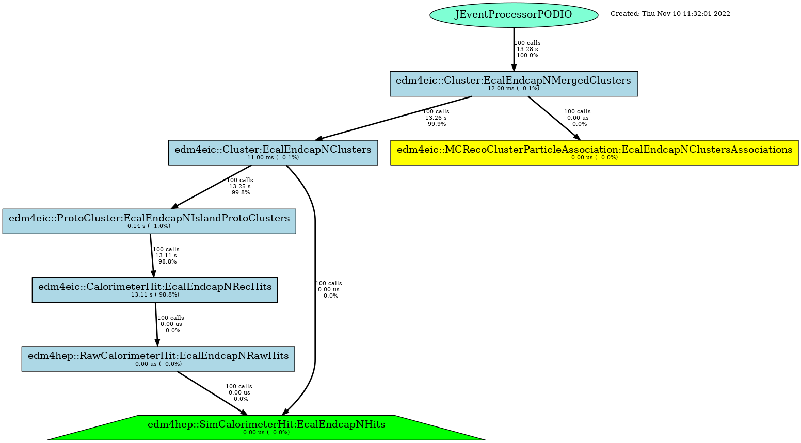

In the plot, the oval at the top is the JEventProcessor making the
initial request for objects. (This is where the *podio:output_collections*
parameter is used). The rectangles in the middle represent factories (i.e. algorithms).
The green trapezoid at the bottom is the object read from the input file.
This is representative of the flow JANA implements. Namely, the requests for
data objects flow from top to bottom and the data objects themselves are
actually created in the order going from bottom to top.

The arrows point in the direction of the request and the numbers next to
them indicate 1.) how many times that request was made, 2.) the total amount of time
spent satisfying the request, and 3.) the fraction of the total time
that represents. The time on an arrow includes everything the requested factory
needed in turn, but only for the first request in each event: later requests are
served from cache. In this example, 100 events were processed and so the request
was made 100 times at each stage. The numbers in the boxes indicate the time
spent in that factory's own code (its *self time*), integrated over all calls,
and the fraction of the total time it represents. A factory's self time is the
sum of the times on its incoming arrows minus the sum of the times on its outgoing
arrows, and the total time is the self time of all factories together. The graphs
written by EICrecon's `callgraph` plugin include a legend with these definitions.

Note that the only factory specified in the above example was for the
`EcalEndcapNMergedClusters` collection. All of the other factories shown
were activated  in order to satisfy the request for the `EcalEndcapNMergedClusters`
objects. If instead we would have specified only the `EcalEndcapNRecHits`, then
only the `EcalEndcapNRecHits` and `EcalEndcapNRawHits` factories would have shown
up in the plot.

## Examples
Below are some example images produced for 100 DIS events. The events were
simulated using the following on the JLab ifarm:

~~~bash
cp /volatile/eic/EPIC/MC_input/SIDIS/Lambda_ABCONV/hepmc_Lambda1_ab_hiAcc_18x275_00.hepmc.gz .
tar xzf hepmc_Lambda1_ab_hiAcc_18x275_00.hepmc.gz
ddsim --compactFile $DETECTOR_PATH/epic_arches.xml --numberOfEvents 100 --inputFiles hepmc_Lambda1_ab_hiAcc_18x275_00.hepmc --outputFile sim_hepmc3_Lambda1_ab_hiAcc_18x275_00.edm4hep.root
~~~

Note that in these examples a relatively small number of events was processed
and the startup time which included reading in the geometry from DD4Hep is
included. Thus, it is often the case that the factory indicating the largest
time is just the first place where the geometry was read in.

| Example images                                                                                 |
|------------------------------------------------------------------------------------------------|
|                                                            |
| 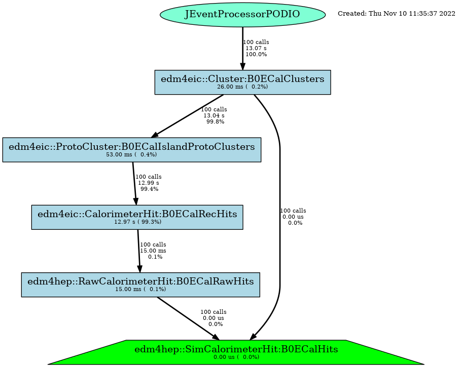                                               |
| 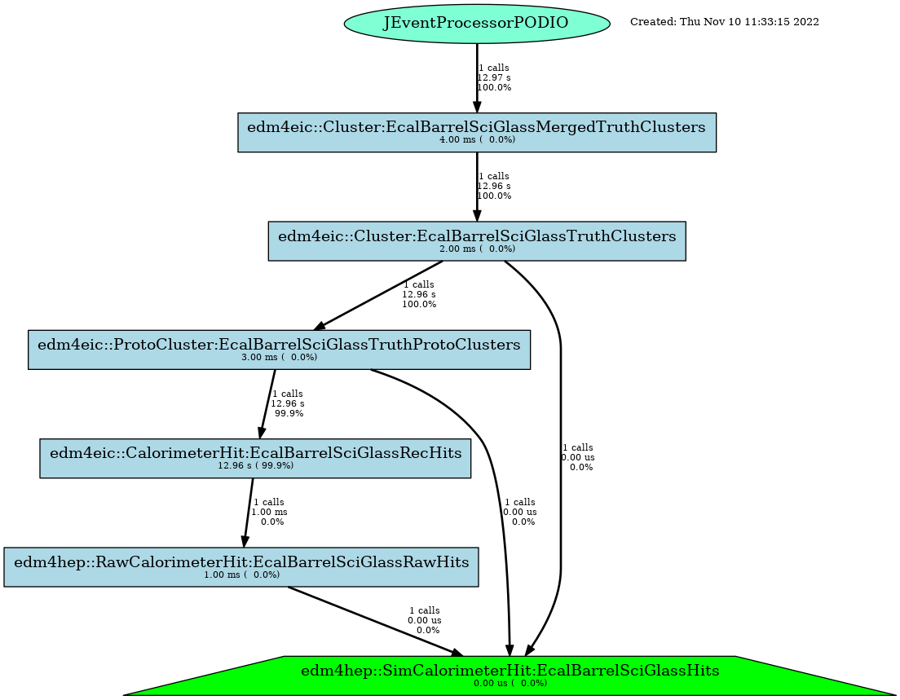 |
| 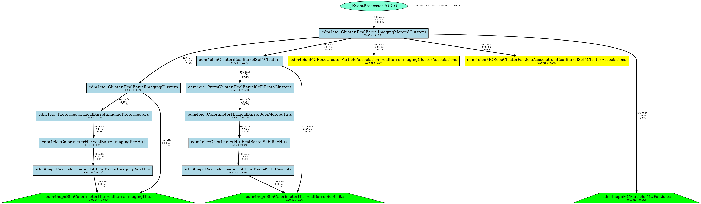             |
|                          |
|                          |
| 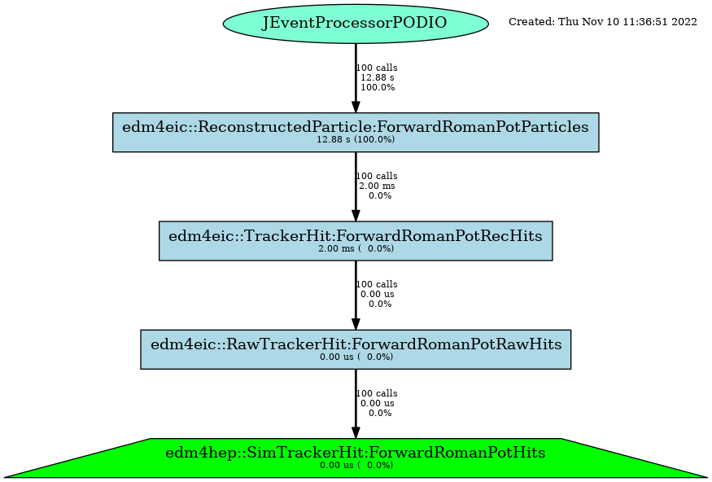                           |
| 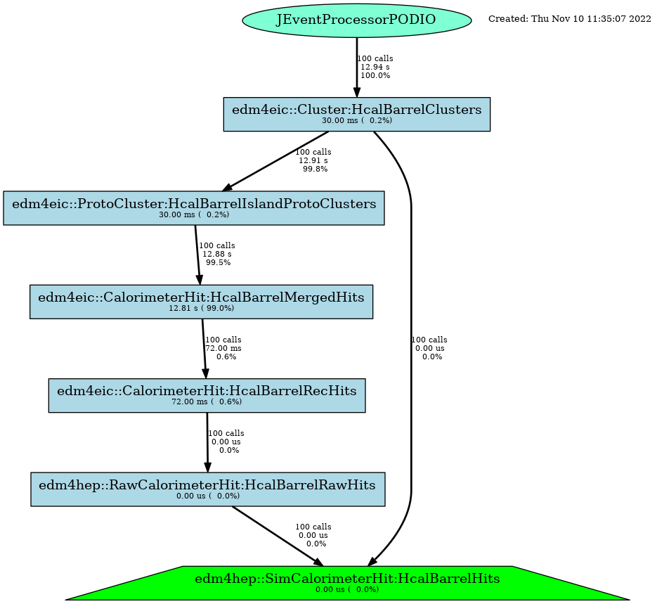                                       |
|                                      |
| 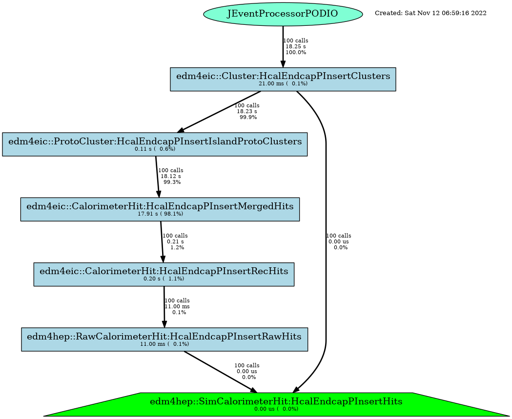                         |
| 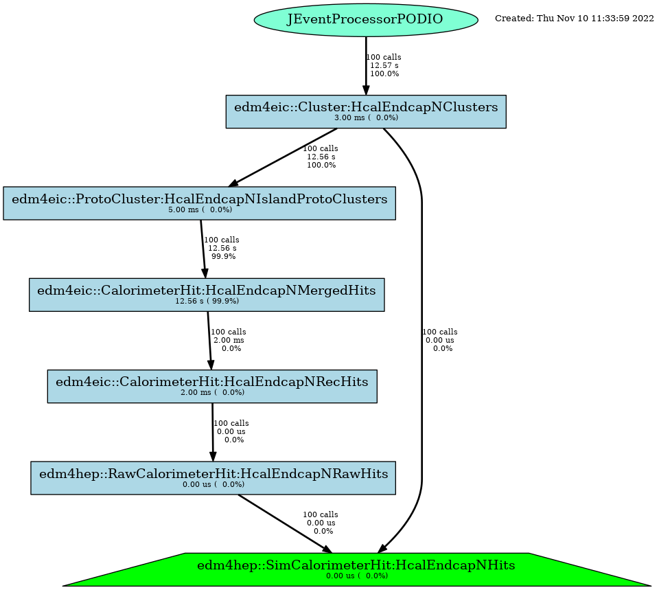                                     |
| 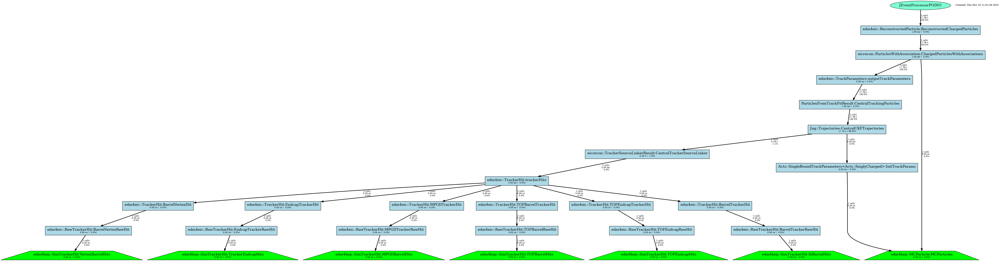                 |
| 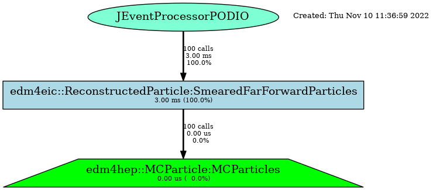                       |
| 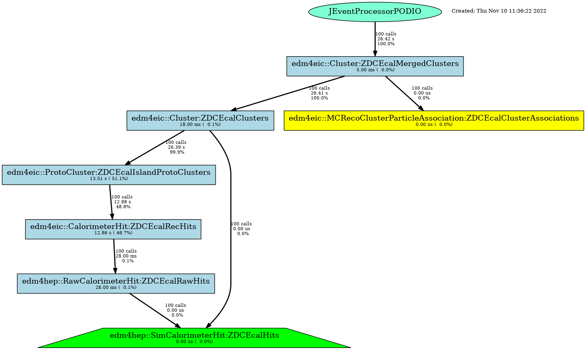                                 |
